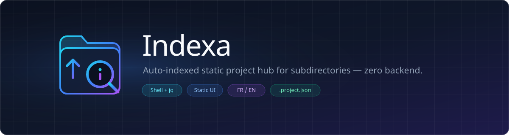

<div align="center">
  
</div>

# Indexa

Page d'accueil statique qui liste automatiquement les projets hébergés en sous-dossiers (`https://projects.example.com/<projet>/`). L'indexation repose sur un script Shell exécuté par `cron`, sans aucun backend applicatif.

## Fonctionnalités

- **Indexation automatique** : parcourt les sous-dossiers contenant un fichier `.project.json` via un script Bash + `jq`.
- **100 % statique** : front-end léger en HTML, CSS et JavaScript vanilla.
- **Recherche et filtres** : filtrage instantané par nom, description ou tags technologiques.
- **Bilingue (FR / EN)** : bascule de langue avec repli automatique sur la description française si la traduction anglaise est absente.
- **Thème sombre / clair** : détection des préférences système et bascule manuelle.

---

## Arborescence sur le serveur

```text
/var/www/projects.example.com/       <- Racine web (Nginx)
├── index.html                       <- Structure HTML
├── styles.css                       <- Styles et variables de thèmes
├── i18n.js                          <- Traductions (FR / EN)
├── app.js                           <- Logique front-end (DOM, recherche, tags)
├── config.json                      <- Liens externes (portfolio, GitHub)
├── projects.json                    <- Généré automatiquement (ne pas éditer à la main)
├── animchronicles/
│   ├── .project.json                <- Métadonnées du projet
│   └── ...                          <- Fichiers du projet
└── autre-projet/
    ├── .project.json
    └── ...

/opt/indexa/
└── generate-projects-json.sh        <- Script de génération
```

---

## Installation

### 1. Prérequis

Installez `jq` pour le traitement JSON :

```bash
sudo apt update && sudo apt install -y jq
```

### 2. Déployer les fichiers statiques

Clonez le dépôt et copiez les fichiers dans la racine web :

```bash
git clone https://github.com/votre-compte/indexa.git
cd indexa
sudo cp index.html styles.css i18n.js app.js /var/www/projects.example.com/
```

Créez le fichier `config.json` à la racine web :

```json
{
  "portfolio": "https://votre-portfolio.com",
  "github": "https://github.com/votre-compte"
}
```

### 3. Installer le script de génération

```bash
sudo mkdir -p /opt/indexa
sudo cp generate-projects-json.sh /opt/indexa/
sudo chmod +x /opt/indexa/generate-projects-json.sh
```

> **Note :** Par défaut, le script cible `/var/www/projects.clem0213.com`. Vous pouvez surcharger ce chemin via les variables d'environnement `PROJECTS_DIR` et `OUTPUT_FILE`, ou en passant le dossier cible en argument (`./generate-projects-json.sh /var/www/mon-dossier`).

### 4. Automatiser avec `cron`

Ajoutez une tâche planifiée pour actualiser `projects.json` toutes les 5 minutes :

```bash
sudo crontab -e
```

```cron
*/5 * * * * PROJECTS_DIR=/var/www/projects.example.com OUTPUT_FILE=/var/www/projects.example.com/projects.json /opt/indexa/generate-projects-json.sh >> /var/log/indexa.log 2>&1
```

### 5. Sécuriser les fichiers cachés (Nginx)

Bloquez l'accès direct aux fichiers cachés (`.project.json`, `.git`, etc.) dans votre configuration Nginx :

```nginx
location ~ /\. {
    deny all;
    access_log off;
    log_not_found off;
}
```

Rechargez ensuite Nginx :

```bash
sudo nginx -t && sudo systemctl reload nginx
```

---

## Ajouter un projet

1. Créez un sous-dossier dans votre racine web : `/var/www/projects.example.com/mon-projet/`.
2. Ajoutez-y un fichier `.project.json` :

```json
{
  "name": "Anim Chronicles",
  "description": "Une courte description du projet en français.",
  "description_en": "A short description of the project in English.",
  "url": "https://projects.example.com/animchronicles/",
  "tags": ["Vue.js", "Firebase", "Tailwind CSS"]
}
```

3. Exécutez le script manuellement ou attendez le prochain passage du `cron` :

```bash
sudo /opt/indexa/generate-projects-json.sh
```